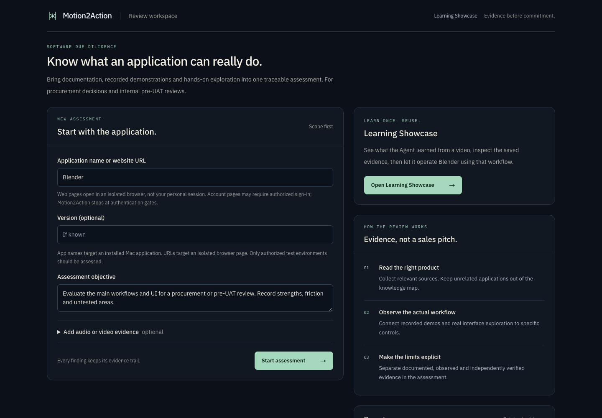
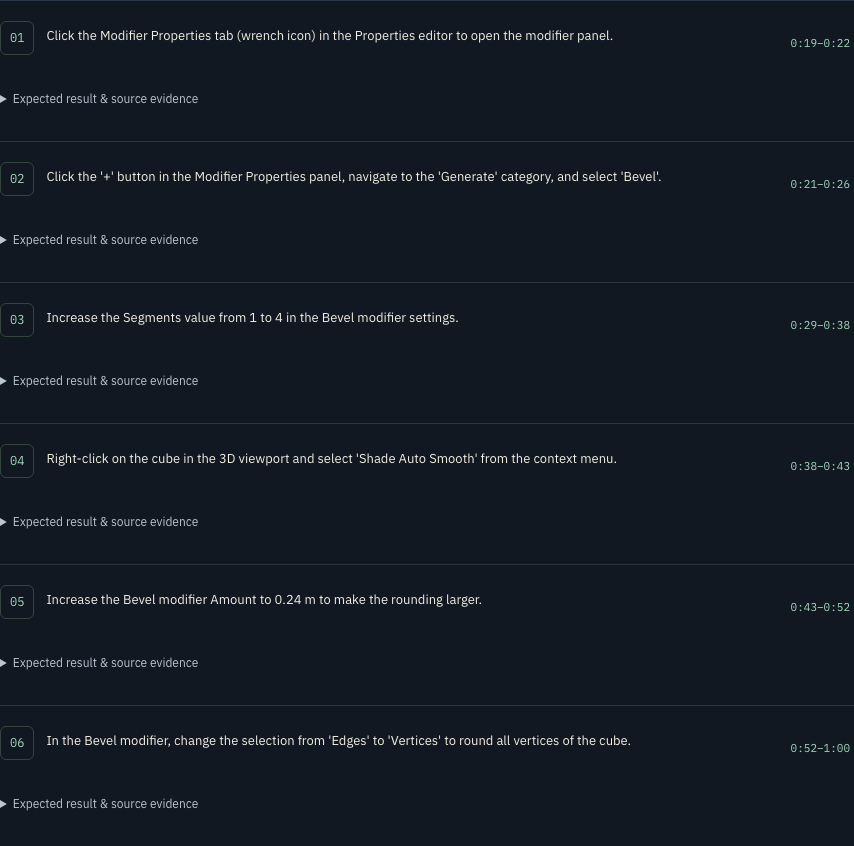
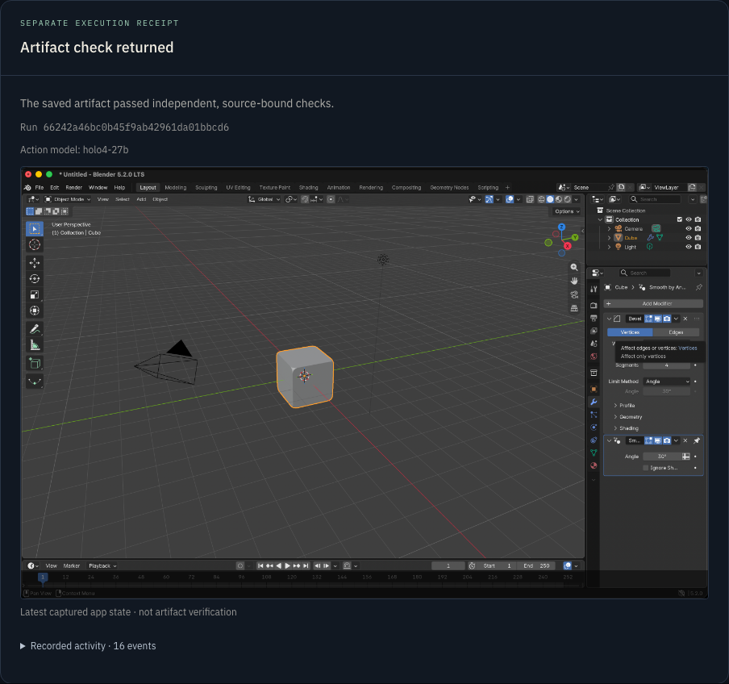
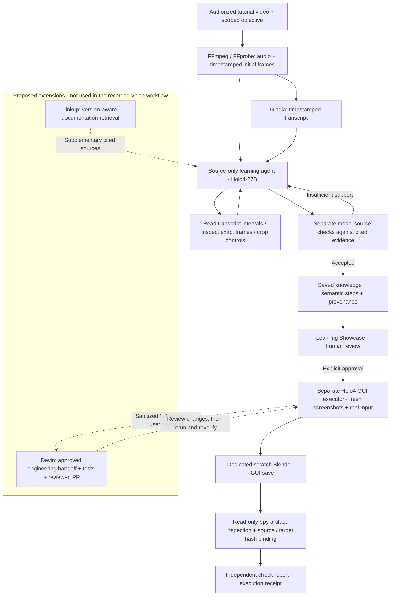
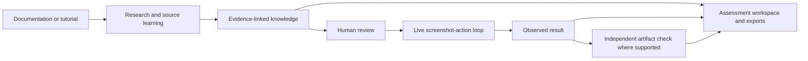

# Motion2Action

**From software demonstrations to traceable knowledge and real computer actions.**

Built for the **H Company × 42AI Computer Use Agents Hackathon**.

Motion2Action helps people answer two connected questions: **What can this application actually do? And can an agent learn a demonstrated workflow and perform it?** It combines documentation, recorded demonstrations and hands-on interface exploration in an evidence-backed workspace. A dedicated video-learning agent turns a tutorial into source-linked steps; a separate executor can reuse those steps to operate Blender and check the saved result.

> Previously named **AppDNA**. The repository, Python identifiers, environment variables and some internal labels retain that name for compatibility.

## See the app in action

These are **real captures of the running local product**, not mockups. The retained demo knowledge and run are local evidence; a fresh clone starts with an empty catalog.

### 1. Define what you want to assess

Choose an application or website and an assessment objective. The workspace explains the evidence and exploration boundaries before starting.



### 2. Review what the video-learning agent actually learned

The saved Blender workflow contains semantic instructions and clickable source time ranges—not a recording of mouse coordinates. Source checking and execution remain separate.



### 3. Inspect the separate execution receipt

The receipt below belongs to the retained successful Blender run. The embedded application capture illustrates the run; the **separate saved-artifact checks** establish the supported result. [Check report and measured values →](docs/EVALUATION.md)



## Technical architecture at a glance

Solid arrows describe the current video workflow. **Linkup already serves assessment research**; using it inside the dedicated video learner is a proposed extension. Devin is not active in this runtime.



**How the video is segmented:** the pipeline extracts audio and an initial frame index, then the learner selects transcript intervals and exact timestamps on demand. It constructs evidence-linked step intervals; it does **not** blindly split fixed-duration clips into actions or replay tutorial coordinates. [Full visual walkthrough, model/tool roles and extension design →](docs/WORKFLOWS.md#8-visual-walkthrough-and-extension-points)

## Why this matters

Before buying software or preparing user acceptance testing, teams must reconcile vendor documentation, demo videos and what the product actually does. Watching a demo is not the same as testing the workflow, and a confident agent summary is not proof of completion.

Motion2Action makes that distinction visible: **documented → observed → independently verified**, with links back to the evidence. Its assessment supports a human decision; it is not procurement approval or formal UAT sign-off.

## For judges: start here

1. **Understand the product:** read the two workflows below.
2. **Follow the agent:** [Workflow & architecture guide](docs/WORKFLOWS.md), including source tools, execution boundaries, persistence and API handoffs.
3. **Inspect what worked:** [Evaluation & evidence](docs/EVALUATION.md), with a source-bound Blender result, measured values, tests and limitations.
4. **Try it locally:** [Quick start](#quick-start). Use your own provider credentials and authorized media; private local runs are not seeded into a fresh clone.

### Workflow A — assess an application

**Input:** an installed Mac application name or public website URL, an assessment objective, and optional audio/video evidence.

1. Research relevant documentation and tutorials with **Linkup**.
2. Extract recording audio and timestamped frames with **FFmpeg**; transcribe spoken evidence with **Gladia**.
3. Use **H Company** to structure claims and candidate capabilities, compare sources with the actual interface, and locate controls from screenshots.
4. Explore the live interface with bounded actions and retain before/after evidence. A website uses an isolated Chromium session, not the user's personal browser session.
5. Present findings, reusable skill descriptions, an interactive knowledge graph and an assessment report. Export a ZIP containing structured knowledge and available evidence/checks.

The assessment distinguishes source-backed knowledge and observed behavior from independent checks. For non-Blender applications, a click trace is **not** an independently verified capability.

### Workflow B — learn a tutorial, then act

**Input:** one authorized YouTube tutorial or uploaded video, plus a scoped learning objective.

1. The **video-learning agent** chooses which transcript passages and video frames to inspect, including crops for small controls or numeric values.
2. It proposes semantic instructions, expected outcomes and timestamped frame citations. Separate model source-check requests must accept every step.
3. The accepted knowledge is saved locally. **Learning Showcase** lets the user inspect steps, seek to source evidence and download the knowledge JSON.
4. **Run with Agent** creates a fresh execution from that checked knowledge. After explicit scratch-scene approval, H Company chooses actions from current Blender screenshots—not recorded tutorial coordinates.
5. Blender saves the scene through its GUI. A separate background Blender process reads the saved file and compares it with **source-derived, pre-execution targets**.

**Concrete result:** a retained run reproduced the learned Bevel workflow and passed **11 source-bound artifact checks**. During this documentation review, the saved file was independently reopened and all 11 checks passed again without changing its hash. This is one bounded workflow result, not a claim of general Blender autonomy. [Inspect the evidence and exact scope →](docs/EVALUATION.md)



## What makes it an agent, not a video summary

- **It chooses observations:** the source learner requests timestamps, transcript intervals and crops within a bounded tool loop.
- **It acts in real software:** live screenshots drive mouse/keyboard actions; semantic steps are reused, not video-coordinate macros.
- **It preserves an evidence trail:** claims, citations, screenshots, action logs and artifact checks remain inspectable.
- **It does not promote observation to proof:** source acceptance, GUI completion and saved-artifact verification are separate gates.
- **It reuses knowledge without inheriting success:** a new execution receives a new job ID, scratch scene and run receipt—not a copied approval, PID or verification result.

## Stack and sponsor integrations

- **H Company / Holo4-27B:** structured source understanding, video-learning decisions, frame inspection, source checking and live GUI action selection. Learning and action model settings are separate.
- **Gladia:** timestamped speech transcription for supplied recordings/tutorials.
- **Linkup:** documentation and tutorial research in the assessment workflow. The dedicated video learner does not need Linkup to learn a supplied source.
- **Next.js 15, React 19, TypeScript, Tailwind, React Flow:** review workspace, graph, evidence player and Learning Showcase.
- **FastAPI, SQLAlchemy, SQLite:** assessment API and local persistence; a separate FastAPI service handles video jobs.
- **FFmpeg, Playwright Chromium, macOS native input and Blender:** media preparation, isolated web exploration, desktop actions and artifact inspection.

Devin is not active in the runtime; Stripe is not part of this prototype. Sponsor integrations above describe actual code paths, not a list of available APIs.

## Quick start

### Requirements

- Python **3.11**, `uv`, Node.js **22** and npm.
- FFmpeg and FFprobe on `PATH`; `yt-dlp` for YouTube ingestion. An authorized local upload is the alternative if downloading fails.
- For real Mac desktop operation: an unlocked macOS session, Accessibility and Screen Recording permissions for the launching terminal/runtime, and the target application installed.
- For tutorial execution: Blender at `/Applications/Blender.app/Contents/MacOS/Blender`, Swift compiler (`swiftc`, supplied by Xcode Command Line Tools), and macOS `sandbox-exec`. There is no unsandboxed fallback. The original assessment adapter separately uses `BLENDER_BIN`.
- Your own H Company, Gladia and Linkup credentials for the corresponding live stages. **Unit tests do not require provider keys.**

The desktop execution path is macOS-specific. A frontend that opens on another OS does not make the executor cross-platform.

### 1. Install and configure

```bash
git clone https://github.com/Hippolyte-Hu/appdna.git
cd appdna
git switch main

uv venv --python 3.11 backend/.venv
uv pip install --python backend/.venv/bin/python -r backend/requirements.txt
cp backend/.env.example backend/.env

# Required for website assessments:
backend/.venv/bin/python -m playwright install chromium

cd frontend
npm ci
cd ..
```

Fill in `backend/.env` using the keys in [the example](backend/.env.example). Keep the file private; it is ignored by Git. `HCOMPANY_BASE_URL` and `HCOMPANY_MODEL` select the assessment provider; the video service's two `APPDNA_*_MODEL` overrides below are process environment variables.

### 2. Start the assessment API — terminal A

From the repository root:

```bash
cd backend
PYTHONPATH=. .venv/bin/uvicorn app.main:app --host 127.0.0.1 --port 8787
```

### 3. Start the video-learning service — terminal B

From the repository root:

```bash
cd backend
APPDNA_LEARNING_MODEL=holo4-27b APPDNA_ACTION_MODEL=holo4-27b \
  PYTHONPATH=. .venv/bin/uvicorn app.tutorial_app:app \
  --host 127.0.0.1 --port 8788 --no-access-log
```

### 4. Start the frontend — terminal C

From the repository root:

```bash
cd frontend
npm run dev -- --hostname 127.0.0.1 --port 3000
```

- **Assessment workspace:** <http://127.0.0.1:3000>
- **Learning Showcase:** <http://127.0.0.1:3000/learning>
- **Video ingestion workbench:** <http://127.0.0.1:8788> — use this to upload/learn a new tutorial. The showcase lists already accepted sources; it is not the upload form.
- **Assessment health:** <http://127.0.0.1:8787/api/health> — reports configuration/Blender availability, not a successful provider call or end-to-end run.

The showcase bridges allowlisted requests through `/api/learning/*` to port 8788. The assessment client uses `NEXT_PUBLIC_API_BASE`, defaulting to `http://127.0.0.1:8787`. If changing that address, set it before starting/building Next.js; assessment CORS currently allows the default localhost/127.0.0.1 port-3000 origins.

**Do not expose these services publicly.** They are local authorized-use tools, not an authenticated multi-user desktop-control service. Creating an assessment can start real exploration. Browsing/exporting saved video knowledge does not start desktop execution. Keep the Mac idle during an approved run; do not run assessments and tutorial execution concurrently. Stop is cooperative and does not interrupt an in-flight provider request immediately.

## Verify the project

```bash
# From the repository root: backend regression suite
cd backend
PYTHONPATH=. .venv/bin/python -m pytest tests -q
.venv/bin/python -m compileall -q app
cd ..

# Frontend presentation contracts and type check
cd frontend
node --test tests/learning.test.mjs
npx tsc --noEmit
cd ..

git diff --check
```

Latest documentation-review checks: **208 backend tests passed**, **13 frontend tests passed**, TypeScript and Python compilation passed. Tests with synthetic fixtures are guard/contract evidence, not a live-model reliability benchmark. See [evaluation details](docs/EVALUATION.md) for warnings, real-run evidence and production-build status.

## Repository map

```text
backend/app/main.py              Assessment API
backend/app/orchestrator.py      Research → understanding → exploration → checks → export
backend/app/agents/              Bounded video-learning agent
backend/app/providers/           H Company, Gladia and Linkup adapters
backend/app/drivers/             Mac, isolated browser and scratch Blender drivers
backend/app/engines/             Learning, execution, provenance, verification and packaging
backend/app/tutorial_app.py      Video ingestion, saved knowledge and execution API
backend/tests/                  Unit regressions and opt-in live/browser scripts
frontend/                       Next.js workspace and Learning Showcase
docs/WORKFLOWS.md                Technical workflow and architecture
docs/EVALUATION.md               Evidence, reproduction and prototype boundaries
tasks/video-agent/               Implementation contracts and historical handoffs
```

Runtime data stays local in `backend/data/` and `tasks/video-agent/evidence/`; neither is committed. A fresh clone will have no historical assessment database or saved video catalog. Exported packages may contain sensitive recordings or screenshots; review them before sharing.

## Prototype boundaries

Video execution currently targets **Blender only**; independent source-derived inspection supports **`blender_bevel_v1`**, not arbitrary scenes or applications. Source audits use a model and can still be wrong. The retained successful execution reuses accepted knowledge; it is not a new from-scratch learning trial. Repeated-run reliability, general-purpose verifiers and automatic publication of video knowledge into the assessment skill graph remain future work.

[Detailed workflows](docs/WORKFLOWS.md) · [Evaluation & evidence](docs/EVALUATION.md)
