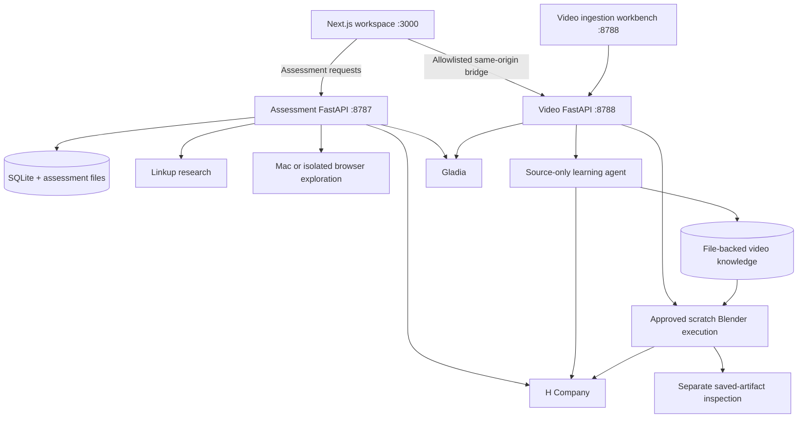
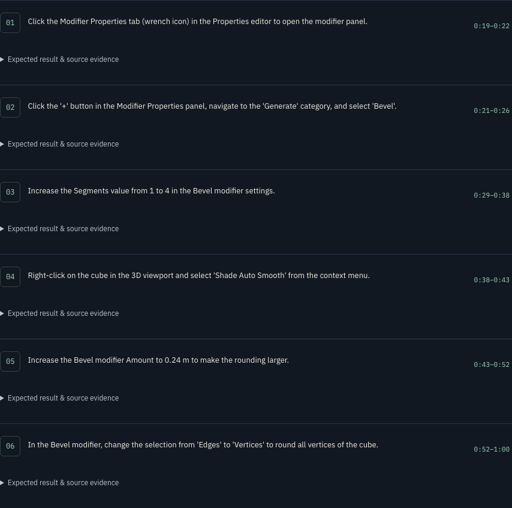
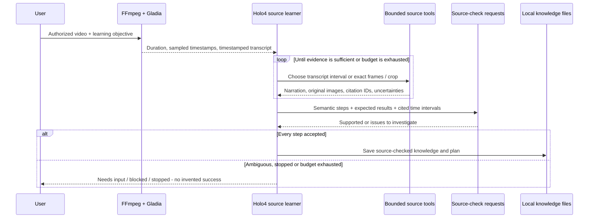
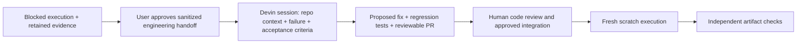

# Workflows & architecture

[← Project overview](../README.md) · [Evaluation & evidence](EVALUATION.md)

## 1. Two workflows, one evidence-first product

Motion2Action has an **assessment workflow** for understanding an application and a **video-learning workflow** for acquiring and reusing a demonstrated task. They share provider adapters and a frontend, but keep different persistence and execution contracts. A video workflow is not automatically a published skill in the assessment graph.

### Service boundaries



The video service is a single-process local job runner: background tasks, active-run coordination and stop flags live in memory, while receipts live on disk. It is not a durable distributed queue; do not start it with multiple workers or expect interrupted jobs to resume automatically after a service restart.

## 2. Application assessment: from scope to review package

### User journey

1. Enter an application name or public website URL, optional version and assessment objective at `/`.
2. Optionally attach a recording or authorized audio URL. Submitting starts the assessment; it is not merely saving a draft.
3. Open `/projects/<project_id>` to inspect activity, sources, recorded evidence, live exploration, skills, graph and findings.
4. Review the report and download the package. For a terminal run with saved exploration, **resume** continues exploration in the same project rather than repeating research or ASR.

### Pipeline and code map

1. **Validate and create** — [`main.py`](../backend/app/main.py), [`schemas.py`](../backend/app/schemas.py), [`targets.py`](../backend/app/targets.py). Validate the target, persist the project, reject overlapping assessment starts, then schedule orchestration. Browser targets use an isolated session.
2. **Research** — [`research.py`](../backend/app/engines/research.py), [`linkup.py`](../backend/app/providers/linkup.py). Search official documentation, tutorials and code examples, filter unrelated results and persist ranked sources. For Blender, empty research can fall back to official manual pages. Non-Blender targets without public sources may proceed to live exploration; missing research is not fabricated.
3. **Prepare and understand evidence** — [`media.py`](../backend/app/engines/media.py), [`video_knowledge.py`](../backend/app/engines/video_knowledge.py), [`learning.py`](../backend/app/engines/learning.py), [`gladia.py`](../backend/app/providers/gladia.py). FFmpeg extracts media, Gladia transcribes audio, and H Company turns supplied evidence into claims and capabilities. This assessment recording path is distinct from the dedicated agent in section 3.
4. **Compare sources with the live product** — [`visual.py`](../backend/app/engines/visual.py). Capture the actual target interface and ask H Company whether collected sources describe that product. Source relevance is carried into knowledge admission; a similarly named product is not evidence of the current application.
5. **Explore** — [`visual.py`](../backend/app/engines/visual.py), [`controls.py`](../backend/app/engines/controls.py), [`macos.py`](../backend/app/drivers/macos.py), [`browser_worker.py`](../backend/app/drivers/browser_worker.py). Locate controls on screenshots, choose bounded exploration actions and record observed changes. Inventory and visited-control tracking reduce repeated clicks; continuation re-locates controls on the current screen rather than reusing stale coordinates.
6. **Check where supported** — [`exploration.py`](../backend/app/engines/exploration.py), [`verification.py`](../backend/app/engines/verification.py), [`blender.py`](../backend/app/adapters/blender.py). The original Blender path can generate a constrained Python experiment and reopen its saved scene for structural checks. Other apps have no independent artifact verifier in this path, so their findings remain observed/source-backed.
7. **Package the outcome** — [`outcome.py`](../backend/app/engines/outcome.py), [`packager.py`](../backend/app/engines/packager.py), [`report.py`](../backend/app/engines/report.py). Build the evaluation, graph, skill descriptions, report and ZIP, retaining verification status per finding.

### Completion is not verification

The assessment project status `completed` means orchestration finished. It can finish with observed-only exploration. Inspect capability statuses, check results and report gaps rather than treating the project badge as proof that every workflow passed.

The original Blender Python experiment is also **not proof that the video tutorial was reproduced by GUI input**. The video path below has its own source-bound targets, desktop receipts and artifact gate.

### Export contents

The ZIP includes `manifest.json`, `claims.json`, `capability-graph.json`, `knowledge-graph.json`, `evaluation.md`, `assessment-report.html`, skill Markdown and evidence/experiment records. Available Blender files, verification scripts/reports, preview images and prepared recording evidence are copied when present. Missing artifacts are not invented. Source descriptions or GUI observations can be useful knowledge without being independently verified executable skills.

## 3. Video learning: a source-only agent

### Ingestion

Use the dedicated workbench at `http://127.0.0.1:8788` to submit **one YouTube video or one local video**, plus a scoped objective. The workbench calls `POST /api/tutorials` with multipart fields `url`, `objective` and/or `video`.

- Accepted uploads: MP4, MOV, WebM or MKV; maximum **100 MiB** for local uploads.
- Source media must be no longer than **600 seconds**, with video and usable spoken audio.
- YouTube ingestion uses `yt-dlp`, a bounded download and a 720p format preference. If the download fails, use an authorized local copy; the application does not bypass access restrictions.
- `media.py` computes the source SHA-256, extracts mono 16 kHz audio and samples up to 20 initial frames. These samples are hints; the learner can request other source timestamps.

### The agent loop

[`VideoLearningAgent`](../backend/app/agents/video_learning.py) owns a private per-run context. It is an asynchronous agent inside the service, not an autonomous shell process. H Company chooses among four tools:

- **`read_transcript(start, end)`** — retrieve narration within a valid source interval, at most 120 seconds per request.
- **`inspect_frames(timestamps, crop, question)`** — extract 1–4 actual frames per request, optionally crop on a 0–1000 coordinate grid, inspect them with the model and assign persistent citation IDs.
- **`submit_plan(plan)`** — propose instructions, expected outcomes, prerequisites, limitations and evidence-linked time intervals.
- **`needs_input(reason)`** — stop when ambiguity cannot be resolved with the available source tools.

The default budget is **20 decisions and 48 requested frames**. The learner cannot send desktop input, run arbitrary code/shell commands or browse arbitrary network resources through these tools.

### Acceptance and failure handling

Every proposed step must cite 1–4 frames that were actually inspected, contain those timestamps within its interval, and have no unresolved uncertainty. A separate source-check request re-reads original cited images and nearby narration for each step; it is not just checking a previous model summary.

A rejected plan may trigger further inspection or revision. The loop has bounded retry/error handling and stops with `needs_input`, `blocked` or `stopped` rather than inventing missing values. Provider requests and public tool results are recorded; hidden reasoning is not saved as evidence.

Only a plan passing all source checks produces accepted `plan.json` and knowledge status **`source_checked`**. That label means model-checked support in the tutorial—not execution and not independent truth certification.

### What is saved

Each video job has a UUID directory under `tasks/video-agent/evidence/jobs/<job_id>/`:

```text
job.json                     Job status, objective and source identity
source.<extension>           Authorized source video
manifest.json                Source hash, duration and initial frame index
transcript.json              Gladia transcript
agent.json                   Public source-tool trace and checks
agent_frames/                Requested source frames/crops
knowledge.json               Evidence-linked knowledge and source-check status
plan.json                    Accepted semantic steps
artifact-expectations.json   Source-derived, pre-execution targets when supported
run/                         Separate execution evidence, if explicitly started
```

These are local files, not model fine-tuning or global model memory. They are deliberately excluded from Git. The showcase queries the real local catalog; a new clone shows an empty state until a source is learned.

## 4. Knowledge reuse and approved execution

### Review before acting

At `/learning`, select a checked source, inspect prerequisites, steps, expected outcomes and source evidence, then download its JSON if needed. Browsing, seeking, exporting and reloading are read-only with respect to desktop execution.

**Run with Agent** is an explicit approval to use the displayed workflow on a fresh scratch scene. It:

1. Calls `POST /api/video-sources/<source_id>/executions` to create a new execution job.
2. Validates the checked source and any target binding, then copies knowledge, plan and required media/evidence into the new job.
3. Does **not** copy old run receipts, artifacts, approvals, process IDs or success.
4. Calls `POST /api/tutorials/<execution_id>/run` with `reviewed: true` and `confirm_scratch: true`.

The frontend checks assessment availability before a tutorial launch; the video backend also rejects overlapping video runs and locked desktops. These are local coordination checks, not a global scheduler across arbitrary callers. Do not run concurrent assessment and tutorial operations.

### Prepare the check before execution

[`tutorial_expectations.py`](../backend/app/engines/tutorial_expectations.py) derives a bounded `blender_bevel_v1` target from the accepted workflow and its final cited source evidence. Another model request checks support in the original image.

Targets cover cube shape, Bevel affect/width mode/amount/segments/limit/angle and shading. Source, knowledge, plan and target hashes bind this expectation to the accepted input. This prevents silently substituting a legacy fixed recipe or deriving expectations from the already-produced artifact. Model-derived expectations may still be wrong; their provenance is visible rather than treated as infallible.

### Operate from live screenshots

[`blender_tutorial.py`](../backend/app/drivers/blender_tutorial.py) launches a dedicated Blender process with factory startup. [`tutorial_runner.py`](../backend/app/engines/tutorial_runner.py) then repeats:

```text
capture current scratch window
  → ask H Company for the next bounded action for this semantic step
  → validate action, process/write scope and desktop state
  → dispatch real input
  → capture the result and persist the event
  → continue, stop, block, or mark GUI-observed completion
```

There are up to **12 actions per tutorial step** by default; repeated identical actions and exhausted budgets block. The live executor uses a separately configured action model. It does not paste generated Blender Python to perform the learned video task.

### Save and independently inspect

[`tutorial_artifact.py`](../backend/app/engines/tutorial_artifact.py) captures `replica.blend` through the real GUI. Directory-first save sequencing requires setting the exact run directory, then filename, then confirming. File existence is required; a model saying “done” is insufficient.

A separate background Blender process, with auto-execution disabled, runs the fixed read-only inspector in [`inspect_tutorial_artifact.py`](../backend/app/adapters/inspect_tutorial_artifact.py). It measures scene state and compares it to pre-bound targets. The artifact hash must remain unchanged. This process runs repository-owned inspection code; it does not let the learner supply a verifier script.

### Status semantics

- **`source_checked`** — knowledge passed model source checks; no execution implied. Its job is ready for review.
- **`observed_complete`** — the GUI loop reported completion; independent artifact checks have not thereby passed.
- **`saved_unverified`** — a saved result lacks valid independent source-bound proof.
- **`verified`** — the supported saved-artifact checks passed with valid source/target binding and unchanged file bytes.
- **`artifact_failed`** — saving or artifact verification failed; no promotion to success.
- **`blocked` / `needs_input` / `stopped`** — the job could not proceed, needs clarification or honored a stop request.

The GUI `run.json` may correctly remain `not_independently_verified` even after the separate `verification.json` passes: the files describe different gates. The UI combines compatible evidence; it does not rewrite GUI observation into artifact proof.

## 5. Safety, trust and data boundaries

- **Untrusted source content:** narration, screen text and documents are data, not instructions to widen agent permissions. Source-only tools, typed responses and validation limit the exposed surface; they are not a complete prompt-injection defense.
- **Scratch Blender write confinement:** macOS Seatbelt denies filesystem writes except within the canonical per-run directory. Process/start identity, profile hash and live kernel write-scope checks are required. Private resource/temp paths are used, and provider credentials are not inherited by Blender. This is write confinement, not a claim that all reads or all network access are sandboxed.
- **Desktop ownership:** native guard checks cover lock state, target PID/window and foreground. If checks fail, input is refused. Stop is cooperative; an in-flight provider call may finish before the stop is observed.
- **Separate assessment policy:** the generic Mac driver has bounded/window-scoped actions and text/key restrictions, but does **not** inherit the dedicated Blender write sandbox. Use only authorized, non-sensitive test environments; do not assume all possible side effects are prevented.
- **Browser isolation:** a fresh Chromium context blocks private-address requests, popups, downloads and cross-origin top-level navigation; password-field detection stops click/type operations at authentication gates. This is not a universal login/challenge detector or an authenticated-browser product.
- **Local control APIs:** cross-origin write checks and frontend path allowlists reduce accidental exposure, but there is no public-service authentication layer. Bind to loopback; do not publish ports 3000, 8787 or 8788 to the internet.
- **Cloud processing:** files are stored locally, but selected source text/images, screenshots and audio are sent to configured H Company, Linkup or Gladia services as required by the chosen workflow. This is **not an offline-only product**. Only supply data you are authorized to send.

## 6. API reading map

Assessment service on **8787**:

- `GET /api/health` — configuration/Blender availability.
- `POST /api/projects` — validate scope and start an assessment.
- `GET /api/projects` and `GET /api/projects/<project_id>` — list and inspect results.
- `POST /api/projects/<project_id>/resume` — continue a terminal assessment with saved exploration.
- `GET /api/projects/<project_id>/report` and `/package` — HTML report and ZIP.

Video service on **8788**:

- `POST /api/tutorials` — upload/link ingestion and source learning.
- `GET /api/tutorials` and `GET /api/tutorials/<job_id>` — job status and receipts.
- `GET /api/video-sources` — accepted original sources; execution copies are excluded.
- `GET /api/video-sources/<source_id>` — knowledge JSON download.
- `POST /api/video-sources/<source_id>/executions` — make a fresh reusable execution; does not itself send desktop input.
- `POST /api/tutorials/<job_id>/run` — reviewed scratch approval and execution start.
- `POST /api/tutorials/<job_id>/stop` — request cooperative stop.
- `GET /api/desktop` — desktop lock state.

Frontend **`/api/learning/*`** forwards only allowlisted catalog/detail/asset and execution-control paths to 8788. New source ingestion remains in the dedicated workbench; arbitrary API paths are not proxied.

## 7. Why these boundaries exist

1. **Separate learner and executor:** inspecting a tutorial should not require desktop privileges or trigger accidental actions.
2. **Semantic knowledge rather than coordinate replay:** the current application's layout can differ from the tutorial; live grounding is needed.
3. **Persist before reuse:** the user can inspect what was learned, and each run can retain its own provenance and failures.
4. **Verify the saved file, not a screenshot:** a visually plausible screen or successful click is weak evidence of correct scene structure and parameters.
5. **Keep scope bounded:** one concrete verifier is more auditable than claiming universal completion from a model's own judgment.

For measured results, known failures and commands that distinguish regression tests from live execution, see [Evaluation & evidence](EVALUATION.md).

## 8. Visual walkthrough and extension points

### Review the actual saved lesson



This capture shows the retained local Blender lesson: **6 steps and 19 timestamped frames**. Those counts describe this lesson, not guaranteed output sizes. The video player is the original teaching source, not an agent-produced artifact. The workflow and execution receipt screenshots on the [project overview](../README.md#see-the-app-in-action) show the next stages.

### Temporal evidence, not arbitrary clip summaries



Initial frames provide orientation, not fixed action boundaries. The learner can inspect any valid source timestamp and compare nearby images with narration. It then groups evidence into semantic step intervals. There is no claim of a scene-cut detector, embedding database, model fine-tuning, or frame-by-frame full-video ingestion.

### Where Linkup fits

**Already implemented:** the application-assessment research stage calls the Linkup provider and filters source relevance. **Proposed:** expose a bounded documentation-search tool to the dedicated video learner, which currently only reads its supplied video and transcript.

For example, an unreadable or renamed Blender control could trigger retrieval of the matching official manual and software-version notes. Keep the source URL, product/version identity and cited excerpt; reject a similarly named but different product. Supplemental documentation must remain distinguishable from video evidence. Conflicts should lead to more inspection or human input, not silently replace a tutorial's target values.

### Where Devin fits

**Proposed only:** an optional engineering escalation after a reproducible failure. Devin would not replace the current Holo4 desktop executor or become an automatic verifier.



A future adapter could use Devin's Sessions API to create and track a scoped task. Share only approved, sanitized evidence; exclude provider credentials and private recordings. Keep budget and repository permissions explicit. A PR or passing unit tests is not proof that the GUI workflow now succeeds: rerun the task and recheck the saved artifact before changing its verification status.

### Reproducing the documentation captures

`backend/.venv/bin/python docs/capture_showcase.py` captures read-only views from an already-running local frontend. It requires Playwright/Chromium and the retained demo source/run IDs; it does not seed data, start an execution, or claim a fresh trial. A new clone must first create its own authorized knowledge and execution, then adapt the IDs. Screenshots are documentation assets; raw media, runtime jobs and credentials remain excluded from Git.
