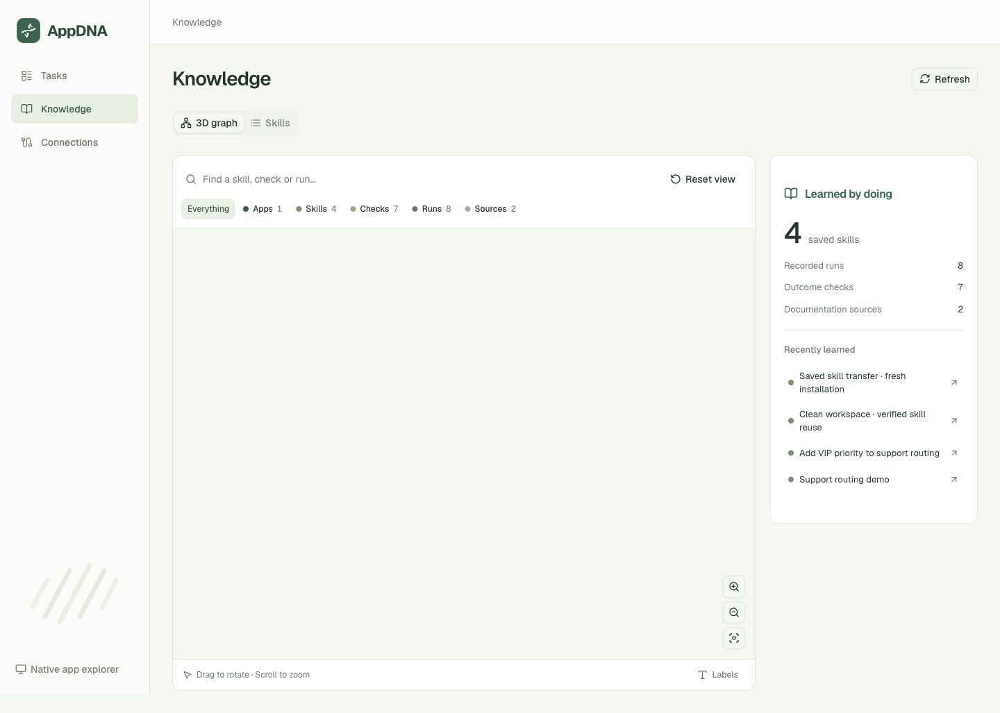
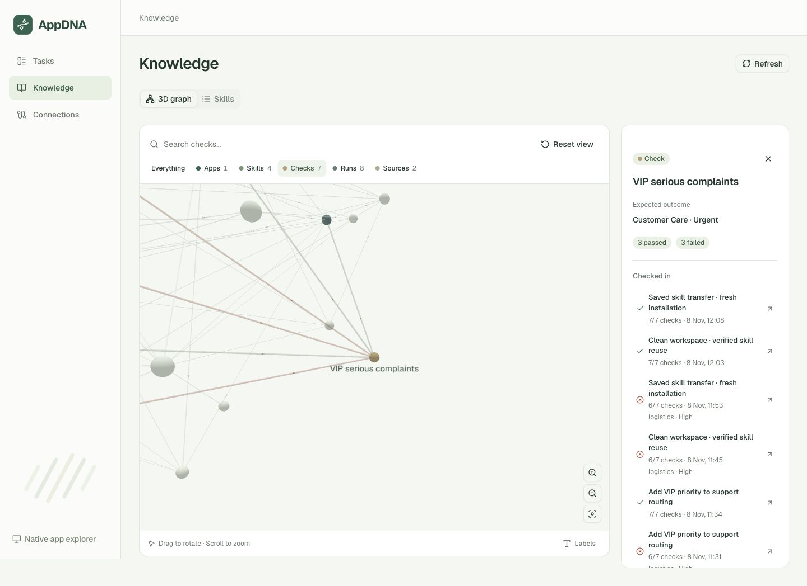
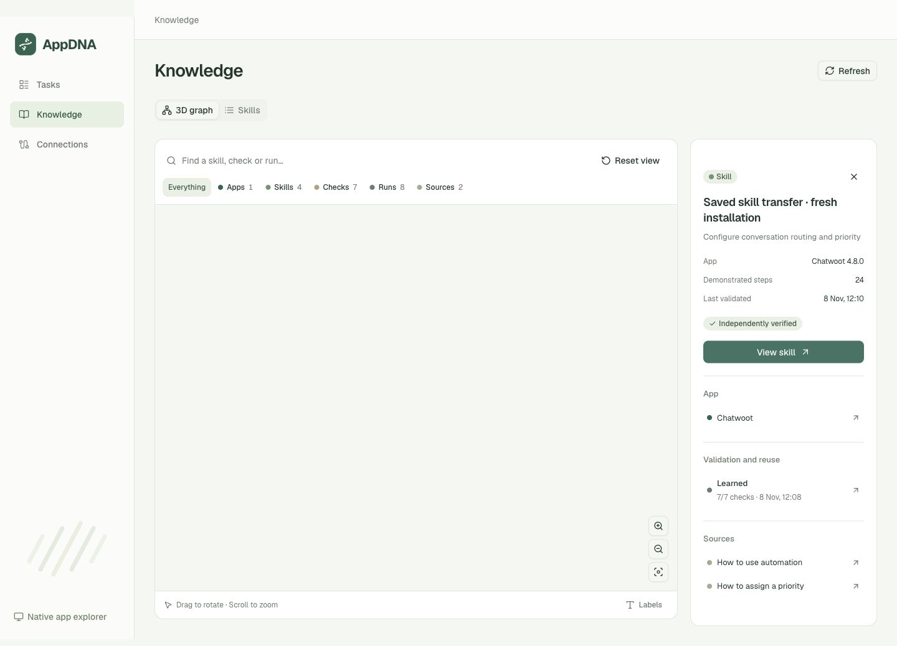

# Interactive learning graph

Open [Knowledge](http://127.0.0.1:3000/knowledge). The default **3D graph** presents saved learning as connected app, skill, run, check and documentation nodes. It uses the existing sage/deep-green theme and official shadcn/ui / Radix controls. The **Skills** tab retains the existing searchable table and recorded procedure drawer.

## Interaction

- Drag to orbit, scroll to zoom, or use the zoom/fit buttons. Reset view restores the full graph.
- Click a sphere or find a node with search. Enter selects the first matching result; all nodes are reachable through search and the inspector's buttons.
- Highlight a node type to emphasize it and its actual neighbors. Labels can be shown for every node.
- Select a skill to see its demonstrated steps, validation status, source run, reuse attempts and documentation. **View skill** opens the existing procedure drawer.
- Select a run to see its status, check count, recorded actions and captured screenshot. **View results** opens that exact run.
- Select a check to compare its expected outcome and the actual outcomes across connected runs, including failures.

The local dataset at verification contained **22 nodes and 73 links**: one app, four skills, eight runs, seven checks and two documentation sources. Those counts reflect the local database, rather than seeded UI content. They will change when more knowledge is saved.

## Evidence and scope

`GET /api/knowledge/graph` is a read-only projection of persisted operational knowledge, task criteria and run evidence. Its edges represent five explicit relationships: app contains skill, skill learned in run, skill reused in run, skill references source, and run checked against criterion. It includes only active skills and their actual source/reuse runs. Superseded artifacts and unrelated cold-control runs remain in history without acquiring invented graph links.

The snapshot includes four completed runs, three failed runs and one blocked run. A skill is marked independently verified only when the complete source task check set passed. Shared checks retain mixed outcomes: **VIP serious complaints** shows three passes and three failures, with expected/actual routing available through each recorded run.

The saved transfer skill `knowledge_455d25f556ea` links to `run_fe3a440452ef`, its actual **7/7** result and **24** demonstrated UI steps. This presentation did not run the model again or alter Chatwoot configuration.

The graph DTO excludes withheld fixture messages, raw target records, action payloads, credentials and browser state. Source links must be HTTP(S) URLs without embedded credentials or query strings. Evidence image paths are validated before inclusion. Empty knowledge produces an empty state; incomplete evidence is not promoted to a verified skill.

Node positions use stable depth layers to make the graph navigable. Spatial distance does not encode learned similarity or confidence. The renderer is dynamically imported in the browser, uses one Three.js runtime, and disposes cached label textures/materials on data replacement or unmount. A renderer error offers retry and the Skills view; that fallback is implemented but was not forced during browser QA.

## Verification

- **92 backend tests passed**, including six graph tests for real relationships, no orphan/duplicate links, superseded entries, mixed/incomplete evidence, empty data and private-data exclusion.
- Frontend type checking and production build passed. The `/knowledge` first-load bundle reported 186 kB; the 3D renderer loads separately on the client.
- Real WebGL rendering, orbit, zoom, sphere picking, fit/reset, search + Enter, type highlighting, label toggle, Skills tab and recorded skill drawer were checked in the in-app browser.
- The graph opened the exact transfer run's 7/7 results page and exposed the actual Chatwoot documentation URL. The selected skill showed 24 recorded steps, rather than generated instructions.
- At 320, 375 and 1440px viewport widths, document width matched viewport width. Canvas widths were 286, 341 and 838px respectively. The temporary viewport override was reset after QA. No browser console errors or warnings were observed.

The screenshot hashes, data fingerprint and interaction checklist are in [knowledge-graph-qa.json](knowledge-graph-qa.json). The [320px capture](screenshots/knowledge-graph-mobile.jpg) records the stacked mobile layout. Existing FastAPI startup and AnyIO deprecation warnings remain in the backend test output.

## Component references

- [react-force-graph](https://github.com/vasturiano/react-force-graph), pinned `react-force-graph-3d` 1.29.2
- [three-spritetext](https://github.com/vasturiano/three-spritetext), pinned 1.10.0
- Three.js 0.187.0, deduplicated across the renderer's dependency tree
- Existing [shadcn/ui](https://ui.shadcn.com/) New York components and Radix UI
