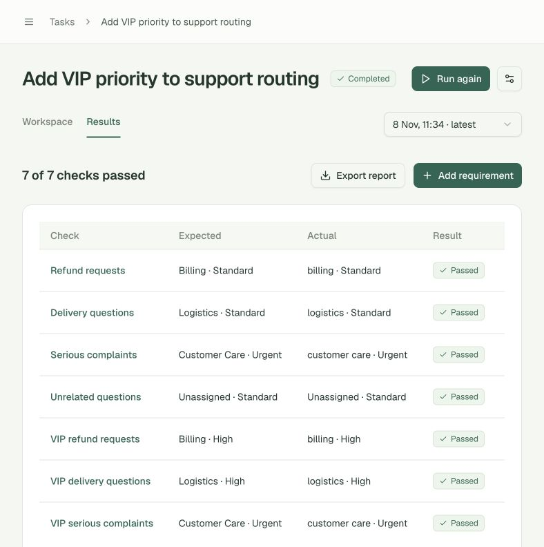
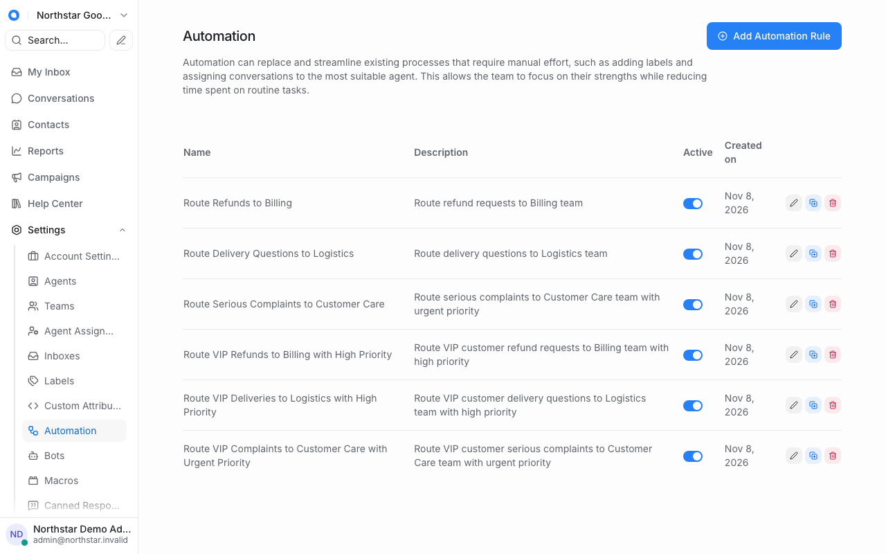
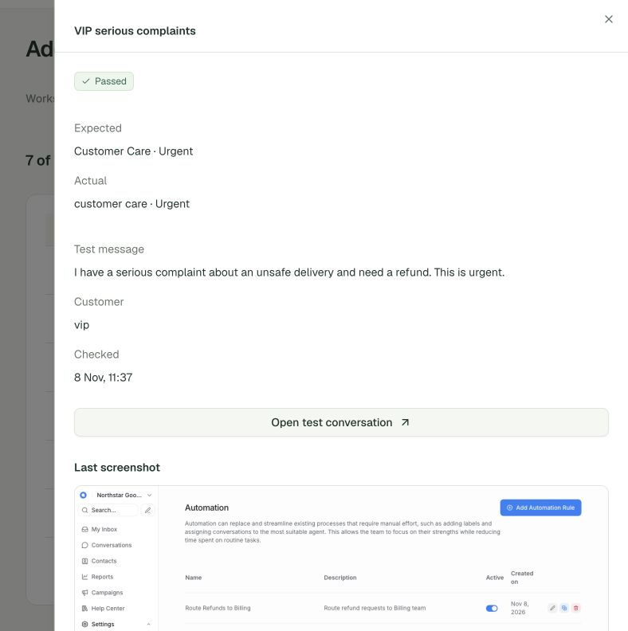
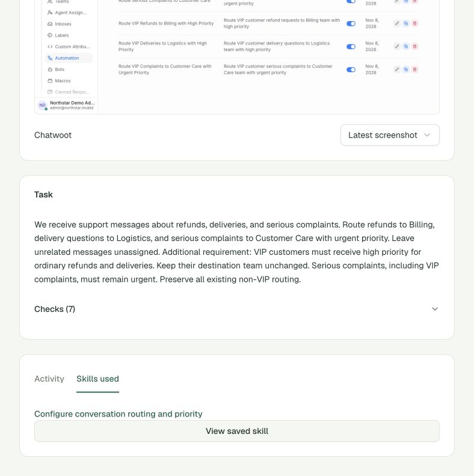
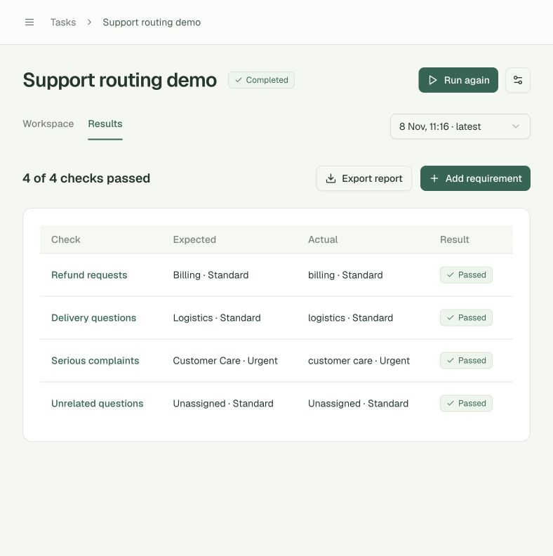

# Live Chatwoot acceptance — 2026-11-08

This is the first, same-account acceptance record. A later [fresh-install transfer and no-skill control](transfer-demo.md) now records the previously unmeasured migration step. The original run evidence below is preserved.

The complete routing → verification → saved skill → VIP follow-up → reuse → verification flow ran against the local Chatwoot CE 4.8.0 sandbox. Configuration was performed by H Company through the observed browser UI. The independent verifier only created synthetic inputs and read resulting conversations.

## Recorded passing runs

| Task | Run | Independent checks | Recorded actions | Executed UI actions | Elapsed |
|---|---|---:|---:|---:|---:|
| Base routing | `run_9fafa2b75467` | 4/4 | 29 | 27 | 135.578 s |
| VIP follow-up repair | `run_0f3292070b33` | 7/7 | 28 | 27 | 141.300 s |

These are passing repair runs, not cold-run totals. Recorded actions also include waiting/research. Elapsed time includes browser observation, inference and verification. Neither run required an inference retry. Recorded action inference had medians of **3.028 s** and **3.026 s**, with maxima of **5.954 s** and **5.088 s**, respectively. The actual requested/reported model was **`holo4-35b-a3b`**.

Open the local [base results](http://127.0.0.1:3000/tasks/task_a8ce72de18a6/results) or [VIP results](http://127.0.0.1:3000/tasks/task_c8e8e6019e5e/results). Run history and full reports are stored in the ignored local database. The checked-in [evidence summary](live-demo.json) contains outcome records, configuration hashes, timings, skill references and screenshot checksums without credentials.

## Final independent outcomes

| Check | Actual team | Actual priority | Status |
|---|---|---|---|
| Refund | billing | default | Passed |
| Delivery | logistics | default | Passed |
| Serious complaint | customer care | urgent | Passed |
| Unrelated question | Unassigned | default | Passed |
| VIP refund | billing | high | Passed |
| VIP delivery | logistics | high | Passed |
| VIP complaint overlapping refund and delivery | customer care | urgent | Passed |

The last check intentionally contains all three routing concepts. It exposed a real precedence bug: **`run_548d13acebf5`** passed 6/7 but routed that VIP complaint to **logistics / high**. No skill was saved for the failed run. The next agent session received only requirement/expected/actual/status feedback, not the withheld message. It created the VIP complaint override through the UI and passed all seven unchanged assertions.

## What changed

- Replaced the stateless browser JSON loop with Holo's native function-calling conversation, matching tool-result IDs and screenshot observation blocks. Private reasoning is neither persisted nor replayed.
- Kept the full action ledger and previous outcome feedback outside the bounded visual window. Research now records its results, deduplicates source URLs and extracts article content instead of navigation menus. Additional research is limited to three calls.
- Added a 45-second inference timeout, one retry for transient failures, responsive cancellation and safe request timing/model metadata. Authentication failures are not retried. The earlier transport stall was no longer reproducible; these changes do not establish its upstream cause.
- Corrected the permission guard so opening a dropdown containing forbidden options is allowed, while selecting outbound email/message/webhook actions remains blocked.
- Kept message-content routing distinct from email subject routing. Earlier failed outcomes supplied corrective feedback without revealing test messages or an executable solution.
- Reconstructed skills locally from actual executed UI actions and linked each step to its action and screenshot. Unexecuted documentation examples cannot become procedure steps. Original summaries remain stored as superseded artifacts.
- Fixed restart recovery so a stale executor stops when another process has already marked its run interrupted. An interrupted VIP attempt is retained separately.
- Made the sandbox seed idempotent for Chatwoot's lowercase team names, cleared the test installation's onboarding flag and followed the normal sign-in redirect during the connection probe. The pinned API serializer's complete unassigned-conversation shape is recognized without treating partial records as successful negatives.

The base verified skill is **`knowledge_35e7f276105d`**. The final VIP run's `knowledge_refs` includes that exact ID. Its updated local skill is **`knowledge_4c4d47a9139c`**, grounded in 27 executed UI steps. The UI's Skills used tab, saved-skill details and successful-run link were inspected. The exported final report's actions and verification records match the database. All **59** referenced execution screenshot files across the two passing runs match their recorded SHA-256 checksums.

## Validation and scope

- **73 backend tests passed**, including native tool history, transient retry, secret-safe errors, hidden-fixture separation, grounded skill extraction, forbidden actions, cancellation, stale-executor recovery and independent verification contracts.
- Frontend `npm run typecheck` passed. The final results page had no captured browser console errors or warnings after navigation.
- The final UI showed **Completed / 7 of 7 checks passed**. JSON export, the overlapping VIP complaint evidence panel, real Chatwoot screenshot and saved skills were checked through the browser.
- The seed passed `ruby -c`. Existing production-build and responsive checks for the unchanged interface remain documented in [implementation.md](implementation.md).

The base pass repaired three rules created during earlier observed attempts; it did not start from an empty configuration. The VIP pass used a new model/browser session on the same synthetic account. **Fresh-environment transfer and a cold/reuse performance comparison have not been measured.** Skills are records of the demonstrated incremental workflows, with current-UI applicability checks; they are not a promised clean-install recipe. Provider availability may still fail in future requests. The original Blender integration is outside this Chatwoot proof and still requires a Blender executable.

## Actual screenshots

Final independent results:

Recorded Chatwoot configuration after the agent's work:

The overlapping complaint's evidence:

Skill reuse in the completed workspace:

Base routing result:

