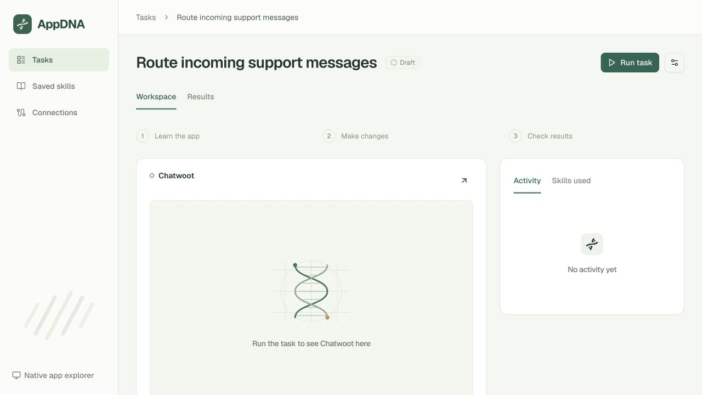
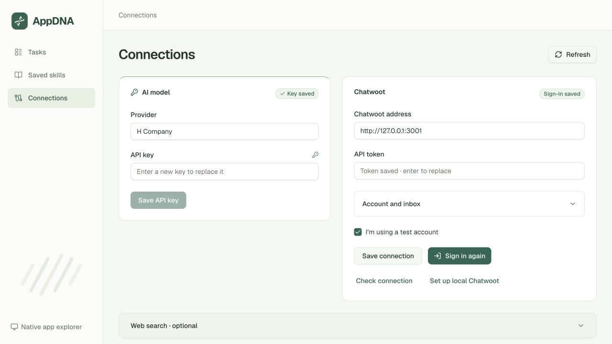
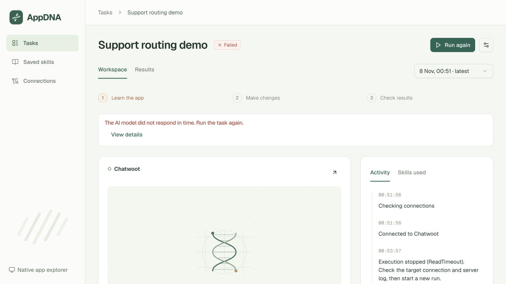
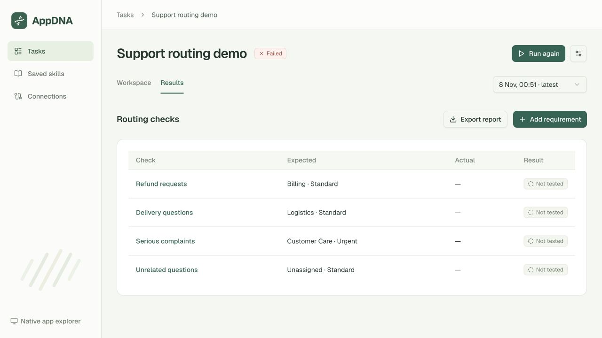

# AppDNA demo — prepared review

Branch: **`codex/computer-use-demo`**. Base: `Hippolyte-Hu/appdna` main at `7833271eb48d1d209cb5d291350288d4c130a990`.

Review the [running demo](http://127.0.0.1:3000/tasks), [Connections](http://127.0.0.1:3000/settings), [implementation record](implementation.md) and [exact source manifest](review-manifest.json).

## Prepared change

- Make the Northstar / Chatwoot business task the primary demo. Preserve the existing native explorer and provider/backend boundaries.
- Use official shadcn/ui New York components, Radix primitives and Tailwind 4. Ant Design is absent from the final dependencies and source.
- Preserve the open layout and concise labels. Add deep green controls, sage surfaces, a DNA brand mark and decorative strand artwork. The artwork is an empty-state illustration, never software evidence.
- Add persistent tasks/run history, SSE, budgets, pause/resume/stop, scoped browser actions and evidence capture.
- Verify withheld synthetic messages independently; never repair rules through the verifier. Require a demonstrated configuration change and complete independent pass before saving knowledge.
- Add VIP follow-up regression checks and saved skills.
- Add usable API key, verifier-token and browser-login setup in Connections. Secret values are neither returned to the UI nor committed.
- Add a pinned Chatwoot CE sandbox recipe, setup helpers, tests, screenshots, dependency lockfile and source attribution.
- Handle model timeouts/access/rate-limit errors with direct, credential-free messages. Preserve actual run history.

## Validation

**58 backend tests**, TypeScript checking, the production build and the dependency audit passed. Twenty responsive geometry checks passed across five pages at 320/375/414/768px. A fresh browser session reported no console errors or warnings. The original native explorer still renders after the Tailwind migration.

Browser checks exercised creation/required validation, budget/time/checkbox persistence, search/status filtering, historical selection, result navigation/refresh, report exports, evidence drawers, a seven-check VIP follow-up and mobile navigation. Credential persistence/redaction tests use a temporary env file.

## Actual live result

Docker and Chatwoot became available during preparation. Run **`run_23f7a2c4752e`** for **`task_a8ce72de18a6`** passed the real API inbox/team preflight, then the H Company planning request timed out after 120 seconds. The model-list endpoint returned 200 and listed the configured model; a separate bounded minimal inference request also timed out.

That run has **zero UI actions and zero routing checks**. It did not demonstrate a configuration change or save a skill. Its historical failed record is preserved; future model failures now receive actionable blocked messages. Complete routing, UI action and fresh-environment transfer acceptance remain unverified. The original Blender integration requires an unavailable Blender executable.

## Pending Git action

After one final human approval, commit the manifest's unchanged source/docs/tests/lockfile/screenshots and push to **`https://github.com/Hippolyte-Hu/appdna.git`**, branch **`codex/computer-use-demo`**.

Proposed commit message: **`Build verifiable computer-use demo with shadcn UI`**.

At preparation time, no commit or push has been performed and approval is pending. This follows the user-provided AGENTS.md instruction, “提交前必须得到一次人工确认的approve”. The intended scope is one commit and branch push, without a merge, PR, deployment or hackathon submission. Local `.env`, generated credentials, sessions, SQLite data, dependencies and build outputs are excluded.

## Screenshots

Draft workspace with the final branding:

Connections, with saved values hidden:

Actual model timeout:

Results remain untested:

