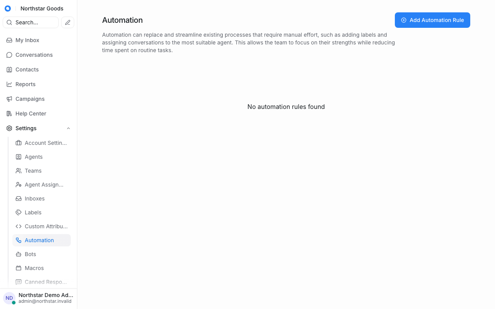
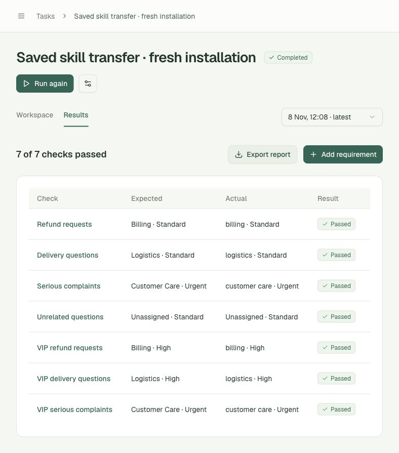
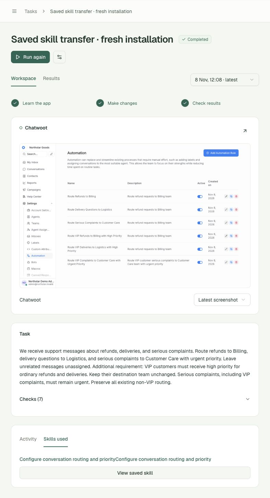
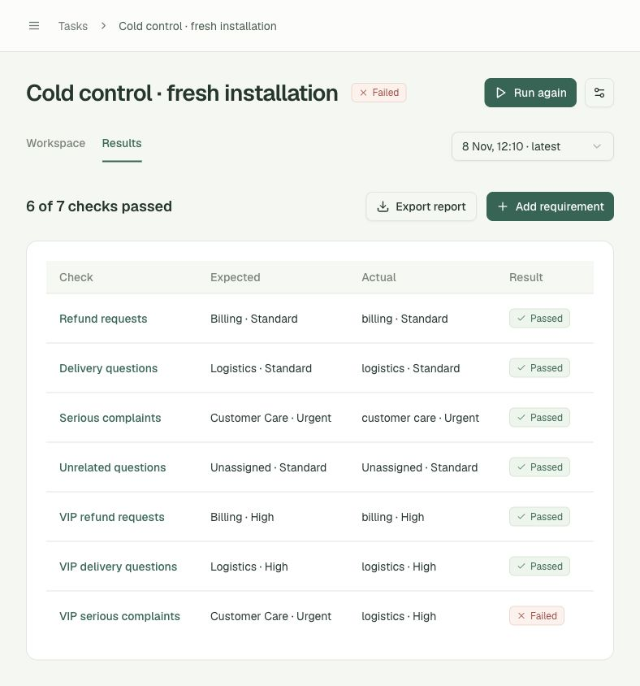

# Fresh-install skill transfer — 2026-11-08

A new H Company agent session used two previously saved skills on an independently installed Chatwoot CE 4.8.0 environment with **zero rules, contacts and conversations**. It reconstructed the routing through the UI, failed the overlapping VIP complaint check on its first attempt, then corrected the configuration using independent outcome feedback. The final run passed **7/7** checks and saved a new grounded skill.

A separate installation ran the same goal without saved skills. Its three observed attempts each passed **6/7**, leaving the overlapping VIP complaint incorrectly assigned to Logistics / High. This is a functional transfer demonstration with a recorded negative control, not evidence of one-shot success or a general speedup.

Open the local [successful transfer](http://127.0.0.1:3000/tasks/task_75752b800f9a/results), [first failed transfer attempt](http://127.0.0.1:3000/tasks/task_75752b800f9a/results?run=run_cfede006d348), or [cold control](http://127.0.0.1:3000/tasks/task_c93edc44a967/results). The [machine-readable evidence](transfer-demo.json) contains every attempt, independent outcomes, configuration/screenshot hashes, volume metadata and source skill IDs.

## Actual comparison

| Arm | Observed attempts | Final result | All recorded actions | Executed UI actions | Sum of run durations |
|---|---:|---|---:|---:|---:|
| Two frozen saved skills | 2 | **7/7, Completed** | 90 | 88 | 427.050 s |
| No saved skills | 3 | **6/7, Failed** | 86 | 82 | 486.998 s |

Counts include failed attempts. Recorded actions also include waiting/research; they are not all UI changes. Durations sum each persisted run's start/end timestamps, excluding queue time and unrelated activity. The control did not complete, so **486.998 seconds is not its time to success**, and the two durations must not be turned into a speedup ratio. There was one installation per arm, no randomized repeated benchmark, and the three control attempts are an observed stopping point rather than a preregistered success-rate study.

| Arm / attempt | Run ID | Actions | Duration | Result |
|---|---|---:|---:|---|
| Reuse 1 | `run_cfede006d348` | 65 | 295.397 s | 6/7; VIP complaint failed |
| Reuse 2 | `run_fe3a440452ef` | 25 | 131.653 s | **7/7; configuration changed; skill saved** |
| Cold 1 | `run_937a2c13e2e5` | 63 | 292.619 s | 6/7 |
| Cold 2 | `run_2e9ab3b14ef8` | 20 | 128.305 s | 6/7 |
| Cold 3 | `run_d4f362370924` | 3 | 66.074 s | 6/7; no configuration change |

The reuse arm's first attempt and all three control attempts returned **logistics / high** for the overlapping VIP complaint. The successful transfer returned **customer care / urgent**, while preserving ordinary refund, delivery, complaint, unrelated-message and VIP refund/delivery behavior. Failed runs saved no knowledge.

## Environment and source controls

- Reuse: Compose project `appdna-transfer-reuse-clean-20261108`, origin `http://127.0.0.1:3004`; new Postgres, Redis and storage volumes created at `10:51:44Z`.
- Cold: project `appdna-transfer-cold-20261108`, origin `http://127.0.0.1:3003`; three different volumes created at `10:51:48Z`.
- Read-only SQL counts before either agent ran were **0 automation rules, 0 contacts, 0 conversations** in both installations. Each first run's independent `configuration_before` was also `[]`.
- The setup seeded only a synthetic administrator, three teams, an API inbox with automatic assignment disabled, and the `customer_tier` attribute. No database or routing rules were copied. The original sandbox was preserved.
- Both arms used the identical public business request, all seven unchanged assertions, `holo4-35b-a3b`, and a 150-action / 1200-second budget per attempt.
- Reuse explicitly froze **`knowledge_35e7f276105d`** and **`knowledge_4c4d47a9139c`**, both validated before this experiment. Both reuse attempts record precisely these IDs. Every cold attempt has `reuse_knowledge=false` and `knowledge_refs=[]`; later saved skills could not enter its context.
- The successful new skill is **`knowledge_455d25f556ea`**, reconstructed locally from the executed UI trace after the independent pass.

During preparation, a candidate installation on port 3002 received unrelated synthetic records. It was excluded. The two formal installations above were newly created and independently checked; no candidate results or unrelated shared-workspace runs enter this comparison.

## Execution and held-out input separation

The profile harness calls the production `execute_run` with a process-local connection and a separate authenticated browser context. It does not edit business configuration, submit a successful UI script, mutate the verifier, or change shared `.env` while a run is active. Ordinary AppDNA pages show the resulting tasks, live activity, screenshots, controls and results.

Both first attempts ran from genuinely empty inboxes. Before either repair arm started, an isolation fix made retries resume the **previously observed settings URL in that same account**. It supplies an actual UI landmark rather than a newly invented path or navigation sequence. Protected retries reject dashboard, inbox or conversation views before observation, so the verifier's newly created messages are not shown to the model. Both arms received the same fix; no business goal, assertion or provider setting was changed.

Retry feedback contains only requirement, expected/actual team/priority and status. It excludes exact messages and raw records. Recorded control labels contain no exact fixture message. The verifier creates synthetic contacts/conversations and reads resulting state; it never repairs a rule, assignment or priority. All **181** referenced execution screenshot files across the five attempts match their recorded SHA-256 checksums.

The final JSON exports' actions and verification records match the database. The UI showed Completed / 7 of 7 checks passed, both source skills, the preserved failed historical run and a working View latest control. The current Connections address is the successful port-3004 installation with its saved sign-in. Workspace links now use each recorded run's environment, including historical runs, rather than whichever sandbox is currently selected globally.

## Reproduce and validate

See [the isolated sandbox instructions](../infra/chatwoot/README.md#fresh-install-transfer-and-cold-control). New helpers refuse to overwrite an existing profile. The connection importer preserves model keys, uses atomic private-file writes, rejects target switching during an active run, and requires a separate browser state path when changing origins. Frozen source IDs are accepted by the production run API as well as the experiment harness.

- **86 backend tests passed**, including frozen source selection, independent setup, no-reset behavior, outcome/fixture separation, observed-entry validation, cancellation, recovery and provider contracts.
- Frontend type checking and production build passed.
- Final result navigation reported no captured browser console errors or warnings.
- Local credentials, browser state, database contents, setup logs and volumes remain outside Git. The checked-in evidence contains synthetic outcome records and non-secret metadata.

This establishes transfer of the supplied saved procedures with one feedback-driven correction. It does not establish reliable one-shot transfer, superiority across applications/versions, or a statistically supported efficiency gain. The newly saved procedure still needs its own future transfer evaluation.

## Recorded screenshots

The new installation before the first automation was created:

The successful migrated configuration's independent results:

Two saved source skills in the completed workspace:

The cold control's final observed failure:

